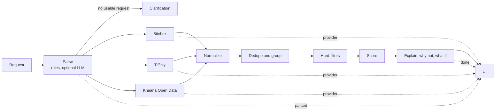

# Thali

[](https://github.com/smitdighe/Thali/actions/workflows/ci.yml)

Thali — a small decision engine for food orders: it reads a request, searches three differently-shaped sources, and recommends one option with reasons taken only from the data.

Demo video: <link>

Built for Algorithec's FLOUNA technical assignment.

## Run it

Prerequisites:

- [uv](https://docs.astral.sh/uv/)
- Node 20.19 or newer (Vite 8 requires `^20.19.0 || >=22.12.0`)
- Python 3.15. `backend/.python-version` pins `3.15` and `requires-python` is `>=3.15`. The build I developed and tested on is the pre-release 3.15.0b3, because the code uses lazy imports (PEP 810). uv fetches the interpreter on `uv sync`.

Backend:

```bash
cd backend
uv sync
cp .env.example .env
uv run uvicorn thali.main:app --port 8000
```

Frontend, dev mode (proxies `/api` and `/mock` to port 8000):

```bash
cd frontend
npm install
npm run dev
```

Open http://127.0.0.1:5173.

One-process demo: run `npm run build` in `frontend/`, then start uvicorn as above. The backend serves `frontend/dist` at http://127.0.0.1:8000 (and the mock providers under `/mock`).

Optional LLM: set `GROQ_API_KEY` in `backend/.env`. Without it the rule-based parser handles every request, and `/api/v1/health` reports `llm_enabled: false`. Other settings use the `THALI_` prefix (see `backend/src/thali/config.py`):

| Setting | Default |
|---|---|
| `THALI_PROVIDER_TIMEOUT_MS` | 1500 |
| `THALI_FETCH_DEADLINE_MS` | 2000 |
| `THALI_RETRY_BACKOFF_MIN_MS` / `_MAX_MS` | 100 / 200 |
| `THALI_BREAKER_FAILURES` | 3 |
| `THALI_BREAKER_COOLDOWN_S` | 30 |
| `THALI_LLM_MODEL` | `openai/gpt-oss-20b` |
| `THALI_LLM_TIMEOUT_MS` | 3000 |
| `THALI_LLM_RPM` | 6 |
| `THALI_LLM_CACHE_SIZE` | 256 |
| `THALI_PROVIDERS_IN_PROCESS` | false (true calls the mock app through an in-process ASGI transport, which the tests use) |
| `THALI_ENABLE_FAULT_API` | true |

## How it works



The dotted lines are the server-sent events of `POST /api/v1/recommend/stream`: `parsed` once the request is read, one `provider` event per source as it finishes, and `done` with the full answer. The UI shows each step as it arrives.

The numbered steps follow the six steps of the assignment:

1. **Understand the request.** The rules parser always runs. The optional LLM can add fields, but each one must quote its evidence from the request. Anything not stated stays null.
2. **Search three providers concurrently over HTTP.** Each has its own protocol and shape. Each call has a timeout, one retry on 5xx or connection errors, and a circuit breaker.
3. **Normalize into one `Listing` model.** Money in integer paise, rating on a 0-5 scale, ETA as low/high minutes, diet, offer. A bad field becomes null and is flagged. A bad record is dropped with a reason. A wrong schema version marks the whole provider as malformed.
4. **Dedupe.** Duplicates inside one provider are collapsed. The same dish at the same restaurant and area across providers becomes one option with several listings.
5. **Rank.** Hard filters for every constraint the user stated, then a weighted score. The cheapest option does not win by default.
6. **Explain.** Templates filled from the score breakdown. No LLM writes any explanation text.

The UI shows each stage: the request with extracted parts highlighted, each provider's status and latency, the pick and its reasons, ranked options with score bars, what was filtered out and why, a System tab with live metrics, and a demo panel that injects provider faults.

## Understanding the request

**Rules parser** (`parsing/rules.py`, vocabulary in `parsing/lexicon.py`). It extracts intent, dish, cuisine, ingredients, diet, budget, delivery limit, minimum rating, the three preferences (rating, price, speed), location and other preferences. Every extracted part records a character span so the UI can highlight it. A bare number with no unit (for example "within 45") is ignored and a note is added; if nothing usable remains, the intent becomes `clarification` and the providers are not called.

**Optional LLM** (`parsing/llm.py`, enabled only when `GROQ_API_KEY` is set). One call to the Groq chat completions API with `temperature` 0, `reasoning_effort` low, a JSON response format, and one few-shot example. The model must return, for every non-null field, `evidence`: words copied from the request.

**Grounding rule** (`parsing/grounding.py`). The model's output is never trusted directly:

- Evidence is searched in the request, ignoring case and whitespace differences. If it is not found, the field is dropped and a note says so.
- Numbers (budget, delivery time, minimum rating) are re-parsed by code from the evidence text. The model's own number is ignored. If the evidence has no usable number, the field is dropped.
- Diet must be one of `veg`, `vegan`, `egg`, `non_veg`.
- Any field the LLM left empty or lost in grounding is backfilled from the rules result.
- If the LLM is unavailable (local rate limit, 429 cooldown, timeout, HTTP error, invalid JSON, unexpected shape), the rules result is used and the response carries a warning and `degraded: true`.

Parsed result for the main query, `Find me a vegetarian biryani under ₹300 that can arrive within 30 minutes. I prefer highly rated restaurants.`:

```json
{
  "intent": "discovery", "dish": "biryani", "cuisine": null, "ingredients": [], "diet": "veg",
  "max_price_inr": 300, "max_eta_min": 30, "min_rating": null, "rating_preference": "high",
  "price_preference": null, "speed_preference": null, "location": null, "other_preferences": [],
  "spans": [
    {"field": "diet", "text": "vegetarian", "start": 10, "end": 20, "source": "rules"},
    {"field": "dish", "text": "biryani", "start": 21, "end": 28, "source": "rules"},
    {"field": "budget", "text": "under ₹300", "start": 29, "end": 39, "source": "rules"},
    {"field": "delivery_time", "text": "within 30 minutes", "start": 56, "end": 73, "source": "rules"},
    {"field": "rating_preference", "text": "highly rated", "start": 84, "end": 96, "source": "rules"}
  ],
  "missing": ["location"], "notes": [], "parser": "rules"
}
```

**Evaluation summary** (copied from `docs/eval.md`; 20 core cases in `backend/eval/core.jsonl`, 5 paraphrase cases in `backend/eval/paraphrase.jsonl`, 12 Hinglish cases in `backend/eval/hinglish.jsonl`):

| parser/set | cases | field accuracy | exact match | invented | missed | wrong |
|---|---|---|---|---|---|---|
| rules/core | 20 | 1.000 | 1.000 (20/20) | 0 | 0 | 0 |
| rules/paraphrase | 5 | 0.954 | 0.400 (2/5) | 0 | 3 | 0 |
| rules/hinglish | 12 | 1.000 | 1.000 (12/12) | 0 | 0 | 0 |
| llm/core | not run | | | | | |
| llm/paraphrase | not run | | | | | |

The LLM rows were not run because no API key was set when the report was generated. The rules parser misses phrasing outside its fixed vocabulary on the paraphrase set (for example "nothing with meat", "plant-based", "well reviewed"), and it never invents a value. The full failure list is in `docs/eval.md`. The core vocabulary was not extended to fit the paraphrase cases.

## Sources and normalization

All three providers are mock services written for this project. They are served by the same FastAPI process under `/mock` and called over real HTTP (httpx), so timeouts, status codes and bodies behave like an external service.

| Provider | Protocol | Format quirks | How it is normalized |
|---|---|---|---|
| Bitebox | `GET /mock/bitebox/v2/search?q=&area=` | Flat JSON, `api_version` `2.x`. Price in rupees as a number, or null when missing. Rating already out of 5. ETA is a single integer. Diet from `is_veg` / `is_vegan` booleans. Offer is free text such as `20% OFF up to ₹50`. Restaurant is a nested object. | `money_to_paise`, `parse_eta`, `parse_count`; offer text parsed into percent or flat with optional cap and minimum order; an unrecognised offer text is kept as an `unknown` offer and gives no discount. |
| Tiffinly | `POST /mock/tiffinly/api/v3/outlets/search` with `{"query": "..."}` | Nested JSON: outlets with menu items. `meta.schema` must be `tiffinly.v3`. Price in paise. Rating as `"9.2/10"`, votes as `"1.8k"`, ETA as a range `"20-30 mins"`, locality like `Andheri (W)`. Uppercase diet tags. Promo is an object (`FLAT`, `PERCENT`, other). | Rating rescaled from /10 to /5. ETA kept as low/high. Area mapped to a canonical name. Diet from tags (vegan, veg, egg, non-veg in that priority). Outlet-level rating and ETA are copied to each menu item. |
| Khaana Open Data | `GET /mock/khaana/v1/listings.csv` | CSV dump of the whole catalogue, query ignored. Header must match exactly. Prices like `₹ 175`, `120` or `N/A`. Diet flag `Y`, `N`, `E`, `VG` or blank. Cuisines separated by `\|`. No ETA and no offers. | Prices parsed to paise. Blank or invalid values become null. ETA stays null. A row with the wrong number of fields is dropped with a reason. |

Common `Listing` fields (`backend/src/thali/models.py`): `listing_id`, `provider`, `provider_label`, `restaurant`, `area`, `item`, `cuisines`, `tags`, `diet`, `price_paise`, `offer`, `effective_price_paise`, `rating` (0-5), `rating_count`, `eta_min_low`, `eta_min_high`, `missing_fields`.

`effective_price_paise` applies the offer: a percent offer is capped by its maximum discount; an offer with a minimum order applies only if the price reaches it; an unknown offer applies nothing. `missing_fields` lists which of price, rating, eta, diet and area are null.

## Imperfect data

| Situation | Behavior | Test(s) |
|---|---|---|
| Provider timeout | Per-provider timeout (1500 ms default) inside a 2000 ms fetch deadline. No retry after a timeout. The response is partial, with a warning and `degraded: true`. | `test_provider_timeout_degrades_gracefully`, `test_slow_handler_times_out_without_retry` |
| 5xx with retry | One retry after a jittered 100-200 ms pause on 5xx or a connection error. 4xx is not retried. After two failures the provider is reported as `error` with 2 attempts. | `test_retry_after_503_then_ok`, `test_503_twice_is_error`, `test_connection_error_is_retried`, `test_4xx_is_not_retried`, `test_provider_error_is_retried_then_reported` |
| Circuit breaker | Opens after 3 consecutive failures, skips the provider without a request for 30 s, then allows one trial call (half-open). | `test_breaker_opens_after_three_failures_and_skips_request`, `test_circuit_opens_after_repeated_failures`, `test_opens_at_threshold`, `test_half_open_after_cooldown_allows_single_trial` |
| Malformed body | Body that is not valid JSON or CSV marks the provider `malformed`; its listings are skipped. | `test_garbage_body_is_malformed`, `test_bitebox_truncated_json_is_malformed`, `test_khaana_non_csv_body`, `test_malformed_provider_response` |
| Unsupported schema version | Bitebox `api_version` not `2.x`, Tiffinly `meta.schema` not `tiffinly.v3`, or a Khaana header mismatch marks the whole provider `malformed`. | `test_unsupported_schema_is_malformed`, `test_bitebox_unsupported_version`, `test_tiffinly_unsupported_schema`, `test_khaana_wrong_header` |
| Missing field | The field is null and listed in `missing_fields`. If the user stated a constraint on it, the listing is excluded with "... not listed by {provider}". | `test_incomplete_provider_data`, `test_bitebox_partial_payload_marks_fields_missing`, `test_tiffinly_partial_payload`, `test_missing_fields_in_order` |
| Invalid field value | The value becomes null and is flagged; the rest of the record is kept. | `test_bitebox_invalid_price_becomes_null_and_flagged`, `test_tiffinly_invalid_price_and_blank_title`, `test_money_to_paise`, `test_rating_out_of_5` |
| Malformed row | The record is dropped with a reason and reported under `dropped`. | `test_khaana_invalid_price_quoted_field_and_dropped_row`, `test_bitebox_drops_bad_records`, `test_tiffinly_drops_nameless_outlet_and_bad_entries` |
| In-provider duplicate | Within one provider, the copy with fewer missing fields is kept (the first on a tie). | `test_in_provider_duplicate_keeps_first_on_tie`, `test_in_provider_duplicate_keeps_listing_with_fewer_missing_fields` |
| Cross-provider duplicate | Same normalized restaurant, area and item across providers merge into one option with several listings. | `test_duplicates_are_merged`, `test_expected_groups_on_full_data` |
| Chain branches | The same restaurant name in different areas stays as separate options. | `test_chain_branches_in_different_areas_stay_separate`, `test_chain_branches_stay_separate_options` |
| Unknown diet | If the user states a diet and the source does not say, the listing is excluded ("vegetarian status not listed by {provider}"). It is not assumed. | `test_unknown_diet_is_excluded_for_veg_request`, `test_bitebox_diet_mapping`, `test_khaana_diet_flags` |
| Offer conditions | Percent caps, flat amounts, minimum-order conditions and unknown offers are handled when computing the effective price. | `test_effective_price`, `test_parse_offer_text_flat_with_minimum`, `test_offer_from_promo_flat`, `test_offer_dependent_budget_text` |

## Ranking

Ranking runs in two stages in `backend/src/thali/pipeline/rank.py`.

**Hard filters.** A check runs only for fields the user stated:

| Stated | Passes when |
|---|---|
| dish | the dish words appear in the item name |
| ingredients | each ingredient word is in the item name |
| cuisine | the cuisine appears in the listing's cuisines, tags or item name |
| diet | veg: veg or vegan. vegan: vegan. egg: veg, vegan or egg. non-veg: non-veg. Unknown diet fails. |
| budget | effective price (after offer) is at most the budget |
| delivery | the upper end of the ETA is at most the limit. Unknown fails. |
| minimum rating | rating is at least the minimum. Unknown fails. |
| location | listing area equals the requested area. Unknown fails. |

Each failure produces a specific violation string, which the UI shows under "filtered out". If nothing passes, the three closest options (fewest violations) are returned as `closest`.

**Score.** `score = sum(weight x value) + bonus`, with each factor value clamped to [0, 1]:

- **Rating:** Bayesian-adjusted, `R' = (v*R + m*C) / (v + m)` with m = 100, C = 4.0, v = number of ratings (25 when the count is unknown). Value = `(R' - 3.0) / 2.0`. Unknown rating scores 0.5.
- **Price:** with a budget, `1 - effective / budget`. Without one, min-max over the feasible listings (0.5 if fewer than two distinct prices). Unknown price scores 0 with a budget, 0.5 without.
- **ETA:** same shape as price, using the upper end of the ETA.

**Weights.** Base: rating 0.4, price 0.3, ETA 0.3. Each stated preference ("highly rated", "cheap", "fast") doubles its factor's weight, and the weights are renormalized to sum to 1. Hard constraints never change the weights. For the main query (rating preference only) the weights are rating 0.5714, price 0.2143, ETA 0.2143.

**Bonus.** +0.03 for each "other preference" whose words all appear in the item name or tags, capped at +0.06.

**Why the Bayesian rating.** A high rating from a handful of ratings should not beat a slightly lower rating from thousands. The adjusted rating pulls small samples toward the prior mean of 4.0, with the weight of 100 ratings.

**Why the upper end of the ETA.** A quoted "25-35 min" can take 35. Checking the upper end against the user's limit means a recommendation never promises a delivery time the source did not.

**Worked example** for the main query (reproduced by `test_main_query_scores_match_worked_example` within 0.0005):

| Listing | Effective price | Rating (count) | ETA | Rating value | Price value | ETA value | Score |
|---|---|---|---|---|---|---|---|
| bitebox:bb_105 Lucknowi Degh, Subz Dum Biryani | ₹235 | 4.8 (950) | 22 | 0.8619 | 0.2167 | 0.2667 | 0.5961 |
| bitebox:bb_101 Dum Pukht House, Veg Dum Biryani | ₹260.10 | 4.6 (2140) | 24 | 0.7866 | 0.1330 | 0.2000 | 0.5208 |
| tiffinly:T-88-4 Dum Pukht House, Veg Dum Biryani | ₹229 | 4.6 (1800) | 20-30 | 0.7842 | 0.2367 | 0.0000 | 0.4988 |
| tiffinly:T-40-2 Tandoor Tales, Veg Biryani Bowl | ₹210 | 4.1 (2300) | 15-25 | 0.5479 | 0.3000 | 0.1667 | 0.4131 |
| bitebox:bb_106 Spice Route Kitchen, Paneer Biryani | ₹260 | none | 25 | 0.5000 | 0.1333 | 0.1667 | 0.3500 |
| bitebox:bb_103 Biryani Junction, Veg Biryani | ₹180 | 3.4 (410) | 28 | 0.2588 | 0.4000 | 0.0667 | 0.2479 |

Dum Pukht House has two listings (Bitebox and Tiffinly) in one option; its option score is the best listing's, 0.5208. The five ranked options are Lucknowi Degh, Dum Pukht House, Tandoor Tales, Spice Route Kitchen and Biryani Junction.

**Why the cheapest does not win.** Biryani Junction is the cheapest feasible option at ₹180, but it is rated 3.4 from 410 ratings and quotes 28 minutes. Its score is 0.2479 against 0.5961 for Lucknowi Degh at ₹235, so it ranks last. Price is one of three factors, and the user asked for highly rated restaurants, which gives rating the largest weight. `test_cheapest_is_not_automatically_best` and `test_cheapest_feasible_option_comes_last` cover this.

**Ties** are broken deterministically: higher score, then lower upper ETA, then lower effective price, then restaurant name, item name and provider name.

## Explanations

Every sentence in `recommendation` is built by a template in `pipeline/explain.py` from fields of the chosen listing and its score breakdown. No LLM writes any of it, so the explanation cannot claim something the data does not show. The pieces are `summary`, `reasons` (only true statements, in a fixed order), `comparison` (the factor where the winner leads the runner-up by the most points), `cheaper_alternative` (a cheaper ranked option and its weakest factor), `also_on` (the other providers listing the same option) and `caveats` (missing rating, a small rating count, a provider that was not compared, a preference no source could confirm, a quoted ETA range).

Output for the main query (asserted in `test_explain.py`):

- Summary: `Recommended because it matches your vegetarian requirement, stays within your ₹300 budget at ₹235 after the offer, has a 4.8 rating from 950 ratings, and has an estimated delivery time of 22 minutes.`
- Reasons:
  - `Vegetarian (marked veg by Bitebox)`
  - `Subz Dum Biryani matches “biryani”`
  - `₹285, ₹235 after 20% off (max ₹50) — within your ₹300 budget`
  - `22 min delivery — inside your 30-minute limit`
  - `Rated 4.8 from 950 ratings — the highest rating among options that fit`
- Comparison: `Ranked above Veg Dum Biryani at Dum Pukht House (Bitebox) mainly on rating: 4.8 vs 4.6.`
- Cheaper alternative: `Veg Biryani at Biryani Junction is ₹55 cheaper (₹180) but is rated 3.4 from 410 ratings.`
- Also on: `Also on Tiffinly, but 25–35 min can exceed your 30-minute limit.`
- Caveats: none.

Every ranked option other than the pick carries a `why_not` sentence from the same breakdown, and every filtered-out option says what failed:

- Dum Pukht House: `Scores 0.5208 vs 0.5961: mainly rating (4.6 from 2,140 ratings vs 4.8 from 950).`
- Biryani Junction: `Scores 0.2479 vs 0.5961: mainly rating (3.4 from 410 ratings vs 4.8 from 950). It is ₹55 cheaper, but price carries 21% of the score here.`
- Green Leaf Cafe (filtered out): `Filtered out: price not listed by Bitebox.`

`what_if` re-runs the ranking with one stated value changed and reports how far the pick holds:

- `The pick holds for any budget from ₹235 to ₹600. Under ₹235, it changes to Veg Dum Biryani at Dum Pukht House (Tiffinly, ₹229).`
- `The pick holds for any time limit from 22 to 60 minutes. Under 22 minutes, nothing fits.`
- `Without the “highly rated” preference, the pick stays the same.`

## API

| Method | Path | Body | Returns |
|---|---|---|---|
| POST | `/api/v1/recommend` | `{"query": "..."}` (1-500 characters after trimming) | 200 `RecommendResponse`, 422 invalid input |
| POST | `/api/v1/recommend/stream` | same body as `/recommend` | `text/event-stream` with events `parsed`, `provider` (one per source, as each finishes), `done`, or `error` |
| POST | `/api/v1/refine` | `{"request_id": "...", "action": "cheaper" \| "faster" \| "better_rated"}` or `{"drop": "<field>"}` or `{"text": "..."}` (exactly one) | `RecommendResponse` for the adjusted request; 404 unknown or expired id, 409 no pick to refine, 422 bad input |
| GET | `/api/v1/health` | none | `llm_enabled`, `llm_model`, breaker state per provider |
| GET | `/api/v1/metrics` | none | request count, p50/p95 total time, the last 30 request times, parser counts (rules, LLM, fallbacks), and per provider: calls, ok rate, p50/p95 latency, timeouts, errors, circuit-open skips, breaker state |
| GET | `/mock/_faults` | none | current fault mode per provider |
| PUT | `/mock/_faults` | partial map, for example `{"tiffinly": "timeout"}` | updated fault state |
| POST | `/mock/_faults/reset` | none | fault state with all providers `ok` |
| GET | `/mock/bitebox/v2/search?q=&area=` | none | Bitebox payload |
| POST | `/mock/tiffinly/api/v3/outlets/search` | `{"query": "..."}` | Tiffinly payload |
| GET | `/mock/khaana/v1/listings.csv` | none | CSV text |

Fault modes: `ok`, `slow`, `timeout`, `error`, `malformed`, `partial`. The `/mock/_faults` routes exist when `THALI_ENABLE_FAULT_API` is true (the default).

Metrics are kept in memory: `requests` and `calls` count everything since the server started; percentiles and rates use the last 500 requests and the last 500 calls per provider.

`/api/v1/recommend` sets `X-Request-ID` (a client-supplied value is echoed) and `Server-Timing: parse;dur=…, fetch;dur=…, rank;dur=…, total;dur=…`. An unhandled error returns 500 `{"error": "internal_error", "request_id": "…"}`.

Trimmed response for the main query (from `docs/samples/01-normal.json`, which the samples script generates with a fixed request id):

```json
{
  "schema_version": "1.1",
  "request_id": "01-normal",
  "query": "Find me a vegetarian biryani under ₹300 that can arrive within 30 minutes. I prefer highly rated restaurants.",
  "parsed": { "intent": "discovery", "dish": "biryani", "diet": "veg", "max_price_inr": 300, "max_eta_min": 30, "rating_preference": "high", "missing": ["location"], "parser": "rules" },
  "clarification": null,
  "recommendation": {
    "option": {
      "restaurant": "Lucknowi Degh", "area": "Bandra West", "item": "Subz Dum Biryani", "rank": 1, "score": 0.5961,
      "best": {
        "listing": { "listing_id": "bitebox:bb_105", "provider": "bitebox", "price_paise": 28500, "effective_price_paise": 23500, "rating": 4.8, "rating_count": 950, "eta_min_low": 22, "eta_min_high": 22 },
        "feasible": true, "violations": [],
        "factors": [
          {"factor": "rating", "value": 0.8619, "weight": 0.5714, "points": 0.4925},
          {"factor": "price", "value": 0.2167, "weight": 0.2143, "points": 0.0464},
          {"factor": "eta", "value": 0.2667, "weight": 0.2143, "points": 0.0571}
        ]
      }
    },
    "summary": "Recommended because it matches your vegetarian requirement, ...",
    "reasons": ["Vegetarian (marked veg by Bitebox)", "..."],
    "comparison": "Ranked above Veg Dum Biryani at Dum Pukht House (Bitebox) mainly on rating: 4.8 vs 4.6.",
    "cheaper_alternative": "Veg Biryani at Biryani Junction is ₹55 cheaper (₹180) but is rated 3.4 from 410 ratings.",
    "also_on": ["Also on Tiffinly, but 25–35 min can exceed your 30-minute limit."],
    "caveats": []
  },
  "ranked": ["5 options"],
  "excluded": ["11 options, each with its violations and why_not"],
  "what_if": ["3 entries, shown under Explanations"],
  "providers": [
    {"name": "bitebox", "status": "ok", "attempts": 1, "records_received": 9, "records_used": 9, "records_dropped": 0},
    {"name": "tiffinly", "status": "ok", "attempts": 1, "records_received": 5, "records_used": 5, "records_dropped": 0},
    {"name": "khaana", "status": "ok", "attempts": 1, "records_received": 8, "records_used": 7, "records_dropped": 1}
  ],
  "dropped": [{"provider": "khaana", "record_ref": "A-6", "reason": "malformed CSV row: expected 9 fields, got 11"}],
  "data_quality": {"records_received": 22, "records_dropped": 1, "duplicates_removed": 1, "merged_options": 4, "listings_with_missing_fields": 11},
  "warnings": [], "degraded": false,
  "trace": {"parse_ms": 23.3, "fetch_ms": 17.5, "rank_ms": 6.1, "what_if_ms": 18.2, "total_ms": 65.9}
}
```

Seven full sample responses are in `docs/samples/` and summarized in `docs/samples.md`: normal request, missing information, provider timeout, incomplete data, preferences, cheap-and-fast, and clarification.

## Tests and evaluation

Commands:

```bash
cd backend
uv run pytest -q
uv run python -m thali.evaluation            # rules rows only
uv run python -m thali.evaluation --write ../docs/eval.md   # also writes the report
uv run python -m thali.evaluation --llm      # adds the LLM rows; needs GROQ_API_KEY
uv run python -m thali.samples               # regenerates docs/samples
```

Results:

- `uv run pytest -q`: 440 passed, 1 warning (a deprecation notice from Starlette's test client about httpx).
- Rules parser on the core set: 20 of 20 exact matches, no invented, missed or wrong fields. `test_rules_parser_meets_core_gate` enforces this.
- Rules parser on the paraphrase set: field accuracy 0.954, 2 of 5 exact matches, 3 missed fields, 0 invented, 0 wrong. This set is scored but not gated.
- Rules parser on the Hinglish set: 12 of 12 exact matches, no invented, missed or wrong fields. `test_rules_parser_meets_hinglish_gate` enforces this.
- LLM rows: not run, because no API key was set. The LLM path is covered by tests against a mocked transport (`test_llm_rows_are_scored_through_the_mocked_transport`, `test_success_returns_grounded_llm_parse`, and the grounding tests), not against the live service.

Required cases:

| Required case | Test(s) | Sample |
|---|---|---|
| Normal request | `test_normal_request_recommends_best_fit` | 01 |
| Missing information | `test_missing_information_stays_null` | 02 |
| Provider failure / timeout | `test_provider_timeout_degrades_gracefully`, `test_provider_error_is_retried_then_reported`, `test_circuit_opens_after_repeated_failures` | 03 |
| Incomplete data | `test_incomplete_provider_data` | 04 |
| Duplicates | `test_duplicates_are_merged` | 01 (data quality) |
| Cheapest isn't best | `test_cheapest_is_not_automatically_best` | 01 |

Tests that involve time use short mock delays (a 600 ms fetch deadline against a 2 s mock sleep) and assert bounds, never exact durations.

## Production notes

- **Timeouts and retries.** Each provider call has its own timeout (1500 ms) inside a shared fetch deadline (2000 ms), and all three run concurrently. A retry happens at most once, only for 5xx or connection errors, after a jittered 100-200 ms pause, and only if the deadline can cover the pause. A timeout is never retried, so a slow provider cannot consume the whole budget.
- **Circuit breaker.** Per provider, in memory. Three consecutive failures (timeout, error or malformed) open it for 30 s. After that one trial request is allowed; success closes it, failure re-opens it for a full cooldown. While open, the provider is skipped with `circuit_open` and the warning says when it will be retried. `/api/v1/health` shows the state of each breaker.
- **Schema version checks.** Each adapter checks the version marker its provider sends (Bitebox `api_version`, Tiffinly `meta.schema`, Khaana CSV header). A mismatch marks the provider `malformed` instead of guessing at a new shape.
- **Quarantine versus nulling.** If a record cannot be identified or used (no id, no restaurant name, no item name, wrong CSV field count, not an object), it is dropped and reported with a reason. If only a field is bad (price, rating, ETA, diet), the record is kept, the field is null, and it appears in `missing_fields`.
- **Observability.** Each request gets a request id (generated, or taken from `X-Request-ID`), which appears in the response header, the body and every log line. Logs are one JSON object per line on stderr with events `request.done`, `parse.done`, `provider.done` and `rank.done`. The response header `Server-Timing` and the body's `trace` give parse, fetch, rank and total milliseconds. `GET /api/v1/metrics` adds rolling latency percentiles, provider health and parser usage; the System tab polls it every 5 seconds while it is open.
- **Quota governance for the LLM.**
  - A token bucket with capacity `THALI_LLM_RPM` (default 6) refilling at `rpm/60` per second. When empty, the parser falls back to rules without any HTTP call.
  - On HTTP 429 the parser stops calling for `Retry-After` seconds (30 if the header is missing).
  - A cache of 256 parsed requests keyed by the lowercased, whitespace-collapsed query. A cache hit makes no HTTP call and uses no bucket token.
  - Failures are never cached.
  - Sizing, based on Groq's published free-plan limits for gpt-oss models at the time I planned this (roughly 30 requests per minute, 1,000 requests per day, 8,000 tokens per minute and 200,000 tokens per day; check the Groq console under Settings, Limits for current numbers): one parse costs about 900-1,000 tokens, so tokens per minute is the binding limit at roughly 8 requests per minute. That is why the default is 6 per minute, which keeps about 200 parses a day within the daily token limit. Beyond that the rules parser takes over.
- **Python 3.15 lazy imports (PEP 810).** Module-level imports are written as `lazy import x` or `lazy from x import y` unless the name is needed while the module itself is being imported. Those stay eager: base classes (`BaseModel`, `BaseSettings`), `Literal` and `Annotated` used in model fields, objects built at module level (`APIRouter()`, compiled regular expressions, `ContextVar`, loggers), and decorators applied at import (`lru_cache`). Ruff's `TID255` rule is enabled to flag lazy imports that resolve immediately. To measure import time: `uv run python -X importtime -c "import thali.main" 2> importtime.txt` (the output file is not committed).

## Beyond the brief

- **Live pipeline:** `POST /api/v1/recommend/stream` sends the parsed request, each source's report as it finishes and the final answer as server-sent events, so the UI shows how the answer is being made.
- **Why not and what if:** each option other than the pick gets a `why_not` sentence from the score breakdown, `what_if` shows how far the pick holds when one value changes, and a price-against-rating chart shows the trade-off.
- **Refinement:** `POST /api/v1/refine` adjusts the last request (cheaper, faster, better rated, drop one requirement, or a follow-up such as "make it vegan") without retyping it; requests are kept in memory for 15 minutes.
- **Phone-first interface:** the pick on top and details in tabs, works at 360 px, dark theme, `?q=` share links, voice input (en-IN) and keyboard shortcuts, so it is easy to use on a phone.
- **Fuller menu:** about 40 more mock items across every dish, cuisine and area the parser knows, so queries beyond biryani return real comparisons.
- **Hinglish:** the rules parser reads common Hinglish phrasing ("300 ke andar", "aadhe ghante mein", "sasta", "shakahari"), checked by a separate 12-case evaluation set.
- **Metrics:** `GET /api/v1/metrics` and the System tab show latency percentiles, provider health and parser usage, so the effect of injected faults is visible.
- **CI:** a GitHub Actions workflow runs ruff, the test suite and the frontend build on every push and pull request to main.

## Limitations and next steps

- Mock data only: one city (Mumbai areas) and three sources.
- Dedupe needs exact normalized names, so the Wok Express "Hakka Noodles" (Bitebox) and "Veg Hakka Noodles" (Tiffinly) stay separate. Next: fuzzy matching, provider IDs and geo data.
- Ratings are rescaled to a 0-5 scale, not calibrated across providers. A 4.5 on one source may not mean the same as a 4.5 on another.
- ETAs are taken at face value. Only the upper end of a range is checked.
- The rules vocabulary is fixed (dishes, cuisines, diets, areas and phrases for preferences). Phrasing outside it is missed by the rules parser; the optional LLM exists to catch some of it, but those rows have not been evaluated.
- "Other preferences" (for example "jain") can only be checked when a source tags them. Otherwise they appear as a caveat saying no source describes them.
- The fault table, circuit breakers, refine sessions and metrics live in process memory, so this runs as a single process and they reset on restart. Several processes would need shared state.
- Weights are hand-set. Next: learn them from order and click feedback.
- The Groq free-tier limits quoted above are from my planning notes and may have changed.

## Libraries, APIs, data and tools

- Backend: Python 3.15, FastAPI 0.162.2, Pydantic 2.14, pydantic-settings, httpx, uvicorn, pytest, pytest-asyncio, ruff, uv
- Frontend: React 19, Vite 8, TypeScript 7 (no UI or state libraries)
- Optional LLM: Groq API, model `openai/gpt-oss-20b`
- Data: three mock providers written for this project (fictional restaurants in Mumbai areas), served from `/mock`. No production commerce services are used.
  - `GET /mock/bitebox/v2/search?q=&area=`
  - `POST /mock/tiffinly/api/v3/outlets/search`
  - `GET /mock/khaana/v1/listings.csv`
- AI assistants used during development: _(Smit to fill in before submitting)_
